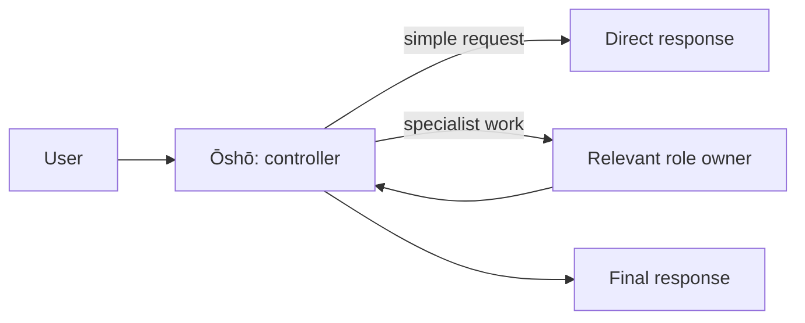

# Shogi

Shogi is a plain-Markdown multi-agent harness organized around shōgi roles.

It is not an SDK and it does not pretend Markdown is a runtime. The repository supplies readable contracts for roles and reusable capabilities, while host plugins provide the few hard runtime policies that need enforcement.

## Architecture

```text
system.md
    global routing, evidence, authority, and shared safety law

agents/*.md
    role identity and ownership boundaries

skills/*/SKILL.md
    portable capability procedures

plugins/
    host-enforced runtime behavior such as skill-mode routing, ambient response gadgets, and progression

manual_plugins/
    optional host integrations such as TencentDB Agent Memory

claude_plugins/
    Claude Code host adapters
```

The layers are intentionally separate. A reusable skill should not need to know the Shogi board, internal agent names, or runtime mode policy.

## Why role separation?

A single agent can easily mix requirements, planning, execution, judgment, and presentation. The board separates those responsibilities so consequential work can use independent ownership without forcing ceremony on simple tasks.

- decisions and user communication stay with one controller;
- specialists contribute only within their role boundaries;
- evidence, execution, and validation remain independently owned;
- simple work can stay simple.



Ōshō is the only user-facing role. Specialists return bounded handoffs rather than addressing the user directly.

## The board

| Role | Responsibility |
| --- | --- |
| **Ōshō — King** | Sole user-facing controller. Preserves constraints, routes work to its owning specialist, and synthesizes grounded results. |
| **Kakugyō — Bishop** | Planning, decomposition, dependency ordering, and orchestration for any work that needs a plan. |
| **Kinshō — Gold General** | Requirements, scope, acceptance criteria, constraints, and definition of done. |
| **Ginshō — Silver General** | Independent evidence-based validation using PASS / FAIL / UNVERIFIED. |
| **Hisha — Rook** | Clear presentation of accepted, evidence-grounded material. |
| **Kyōsha — Lance** | Read-only evidence gathering, repository inspection, and public-web research. |
| **Fuhyō — Pawn** | One bounded, checkable execution operation at a time. |
| **Keima — Knight** | Bounded adversarial challenge of risks, assumptions, continuity, or persona fidelity. |

## Skills

Skills are reusable capabilities. Their `SKILL.md` files describe **how to perform the capability**, not how this repository routes agents.

The default portability target is one skill directory. Sibling skills may be optional integrations, but a reusable skill should keep a complete semantic path of its own unless an external runtime/toolchain is intrinsically required. Compose through meaningful inputs, not repository-specific orchestration state.

Examples:

```text
Good: requires an approved behavior contract
Good: accepts a trusted vault descriptor
Good: accepts independent review evidence

Bad: requires an internal next-agent token
Bad: embeds a board executor identity
Bad: declares the host runtime mode inside the skill
Bad: consumes an opaque versioned envelope only another local skill can produce
```

Availability and execution of configured mode-managed JohnnyDecimal skills belong to the mode-router plugin.

### JohnnyDecimal layout

| Index | Prefix | Description |
| --- | --- | --- |
| 00 | `00-agent-` | Agentic utilities and persona/system helpers |
| 01 | `01-doc-` | Documentation and writing |
| 02 | `02-excalidraw-` | Excalidraw diagramming |
| 03 | `03-kb-` | Knowledge-base capabilities |
| 04 | `04-git-` | Git and version control |
| 05 | `05-dev-` | Development methodology and review |
| 06 | `06-python-` | Python-specific capabilities |
| 07 | `07-opencti-` | Reserved for OpenCTI capabilities |
| 08 | `08-openaev-` | Reserved for OpenAEV capabilities |
| 09 | `09-rp-` | Roleplay chatbot |
| 10 | `10-rpg-` | Portable tabletop session, scene, character, journal, and resolution capabilities |
| 11 | `11-shadowrun-` | Shadowrun Sixth World (6E) lore, rules, and runs |
| 12 | `12-cyphersystem-` | Cypher System SRD rules, characters, and adventures |
| 97 | `97-gadget-` | Optional response gadgets |
| 98 | `98-external-` | Imported/external helper capabilities |
| 99 | `99-tool-` | General tools and utilities |

## Runtime modes

Persisted session mode and the availability and execution of configured managed JohnnyDecimal skills are enforced by `plugins/mode-router-v2`.

The router owns the mode names, child-session inheritance, managed skill patterns, persisted session state, and `/mode` command. Native/system/harness tools and board-subagent availability are outside its authority and remain governed by host permissions and agent contracts. Skills and agent contracts do not duplicate managed skill-mode rules.

Edit `plugins/mode-router-v2/modes.yml` when the runtime skill families change.

The router targets the OpenCode V2 pre-model `context` hook and enforces configured managed JohnnyDecimal skill policy before every model dispatch, not merely when a `/mode` command is issued. It filters those managed skills from catalog advertisements and guards explicit JohnnyDecimal `/skill-id` invocation, `skill`-carrier calls that name a managed JohnnyDecimal skill, and direct managed JohnnyDecimal tool invocation. If request or session identity cannot be resolved, only configured managed JohnnyDecimal skills fail closed; the native tool surface never does. Native/system/harness tools and board subagents remain untouched by the router. Child subagent sessions inherit their parent session's mode.

The gadget skills (`97-gadget-*`) are not mode-managed: they pass through to normal host permissions.

### Per-session plugin policy

The router is also the per-session authority for the runtime plugins listed under `managed_plugins` in `modes.yml`: `kakudou.response-gadgets`, `kakudou.otsumi-progression`, and `kakudou.tencentdb-memory`. A managed plugin is enabled in a session only when the active mode lists it under `plugins:` (a mode that `extends` another inherits its parent's list).

| Mode | Response gadgets | Progression | TencentDB memory |
| --- | --- | --- | --- |
| `dev`, `dev-python` | enabled | enabled | enabled |
| `chatbot` | disabled | disabled | disabled |
| `gamemaster` | disabled | disabled | disabled |

Each plugin re-checks this policy before its own effects (selection, XP awards, memory capture, plugin tools) and fails closed when the policy cannot be resolved.

## Ambient response gadgets

`plugins/response-gadgets-v2` owns the occasional Fun Fact, News, and SRS selections. The three gadget skills remain ordinary portable capabilities; they do not contain their own probability gates or know which agent selected them.

Selection is evaluated once per eligible user turn, survives tool-continuation requests without rerolling, and never creates a second synthetic assistant turn. Gadget appendices use generic `otsumi-ephemeral` markers so TencentDB capture can exclude ambient display-only material from durable memory.

The default ambient policy is enabled for ordinary work modes and suppressed for locked chatbot/gamemaster modes so a random out-of-character appendix cannot violate persona or narration format. The plugin accepts an explicit mode override when a deployment wants different ambient behavior; manual gadget invocation remains independent of the random selector.

## Progression

`plugins/otsumi-progression-v2` (`kakudou.otsumi-progression`) runs Ōtsumi's RPG-like progression loop on OpenCode V2. It owns only durable game state: XP, level, activity counters, a per-input award ledger (stable IDs or privacy-safe hashes, never user text), one pending evolution slot, the current evolution proposal, rejected proposals, and completed evolution history. It does not implement evolutions, grant permissions, replace TencentDB memory, or write Obsidian knowledge.

Each eligible primary-agent user input earns at most `+1` interaction, `+1` completion, and `+3` effective-work XP; gadget-only work, skill loading, `otsumi_rng`, and TencentDB tools earn no effective-work bonus. A pending level-up is announced through a pre-model directive and resolved with the `00-agent-evolution` capability. The plugin exposes `otsumi_progression_status`, `_propose`, `_reject`, and `_complete` tools plus a read-only `/otsumi` character sheet. State defaults to `$XDG_STATE_HOME/opencode/otsumi-progression-v2/otsumi.json` (or `~/.local/state/...` when unset). See [its README](plugins/otsumi-progression-v2/README.md).

## Obsidian

Obsidian topology is configuration, not global system law.

`03-kb-obsidian-vault-overview` is the authority for configured vault roots, root groups, templates, conventions, and vault safety metadata. Other Obsidian skills consume that configuration rather than hardcoding the vault layout.

## Memory

Durable memory is provided by [TencentDB-Agent-Memory](https://github.com/TencentCloud/TencentDB-Agent-Memory).

`manual_plugins/tencentdb-agent-memory/tencentdb` integrates it with OpenCode and adds the local dream workflow. Memory schema, retrieval, persistence, and retention belong to that infrastructure rather than to `system.md` or ordinary skills.

Obsidian knowledge and TencentDB memory are separate systems.

Memory capture and memory tools follow the router's per-session plugin policy, so they are off in modes that do not list `kakudou.tencentdb-memory`.

## Repository layout

- [system.md](system.md) — global system law and routing invariants.
- [agents/](agents/) — the eight role contracts.
- [skills/](skills/) — reusable capabilities at `skills/<name>/SKILL.md`.
- `skills/synced/` — a synced bucket directory (one ID-named folder) holding externally sourced skills (`docs`, `docx`, `google-workspace`, `import-memory`, `morning`, `pdf`, `pptx`, `skill-creator`, `xlsx`), listed with their `source` (`anthropic` / `anthropic-example`) in its `manifest.json`. These are not JohnnyDecimal skills of this repository.
- [plugins/](plugins/) — automatically loaded OpenCode plugins / hard guardrails.
- [manual_plugins/](manual_plugins/) — optional integrations that must be configured explicitly.
- [claude_plugins/otsumi/](claude_plugins/otsumi/) — the Claude Code mod and the host-free cores it shares with the OpenCode plugins (response gadgets so far).
- [sample-opencode.json](sample-opencode.json) — example OpenCode configuration.

## Install

Clone the repository:

```bash
git clone git@github.com:Kakudou/agentic-system.git ~/.agentic-system
```

### OpenCode

```bash
ln -s ~/.agentic-system/system.md ~/.config/opencode/AGENTS.md
ln -s ~/.agentic-system/agents ~/.config/opencode/agents
ln -s ~/.agentic-system/skills ~/.config/opencode/skills
ln -s ~/.agentic-system/plugins ~/.config/opencode/plugins
ln -s ~/.agentic-system/manual_plugins ~/.config/opencode/manual_plugins
```

The `plugins/` symlink provides the hard runtime plugins. Configure manual integrations separately in the OpenCode configuration as needed; see [sample-opencode.json](sample-opencode.json).

Set OpenCode V2's `default_agent` to `osho` (as in the sample configuration) so ordinary sessions enter through the repository's sole user-facing controller rather than the host's built-in primary agent.

Keep OpenCode V2's default `experimental.subagent_depth` of `1`. Delegation is single-level: Kakugyō returns a dispatch plan and Ōshō performs every spawn, so no subagent ever launches another (the same shape Claude Code enforces). Ordered per-agent `subagent` permission rules let only Ōshō spawn, and only the Shōgi board IDs, so built-in/general agents are not a bypass around Fuhyō or the other ownership boundaries.

For TencentDB memory, map each Shogi agent to its own Tencent `agent_id`. Leave an agent unmapped rather than using a shared fallback unless shared memory identity is explicitly intended.

TencentDB setup:

```bash
cd ~/.agentic-system/manual_plugins/tencentdb-agent-memory
cp source_env.example source_env   # then replace every placeholder value
```

`source_env` holds real secrets; it is untracked and git-ignored. Keys previously committed in `source_env` remain in git history; rotate them. History scrubbing is a separate owner step.

### Claude Code

`system.md` is the global contract; point `~/.claude/CLAUDE.md` at it and the agent files at `~/.claude/agents` as you would for the other hosts.

The Ōtsumi Claude Code mod lives at [`claude_plugins/otsumi`](claude_plugins/otsumi/). Load it for one session with `claude --plugin-dir claude_plugins/otsumi`, or for every session by naming the folder in `CLAUDE_CODE_PLUGIN_DIRS`. It currently ports the response gadgets only; the mode router and progression are not yet ported.

Ambient gadgets are controlled by `OTSUMI_GADGETS_MODE`:

- unset, empty, or `dev` → ambient gadgets on (default);
- any other value, such as `off`, `chatbot`, or `gamemaster` → ambient gadgets suppressed.

Manual `/gadget` and `otsumi_rng` are unaffected by this switch.

Claude Code's main thread is not `osho`: it runs the host's default agent with `system.md` as instructions. The board's controller only runs as the main thread if you start Claude Code with `osho` as the main agent.

The read-only agents' `disallowedTools` denylist covers the built-in mutation, messaging, scheduling, and publishing tools; MCP-connector write tools are not covered by it.

### Copilot

```bash
ln -s ~/.agentic-system/system.md ~/.copilot/copilot-instructions.md
ln -s ~/.agentic-system/agents ~/.copilot/agents
ln -s ~/.agentic-system/skills ~/.copilot/skills
```

Host-specific delegation adapters remain the host's responsibility.

## Design principles

- **One public voice.** Ōshō owns user-facing communication and final synthesis.
- **One owner per concern.** Requirements, planning, execution, validation, research, challenge, and presentation remain distinct.
- **Portable skills.** Capability procedures do not depend on this board or its runtime mode implementation.
- **Evidence over assertion.** Never convert plans, expectations, or missing evidence into observed success.
- **Runtime policy in runtime code.** Hard enforcement such as skill modes belongs to plugins, not prose duplicated across skills.
- **Configuration has an owner.** Obsidian topology belongs to the vault-overview skill; durable memory belongs to TencentDB.
- **Plain contracts.** Keep the repository inspectable and understandable without hidden workflow schemas.

## Fiction-first tabletop RPG (gamemaster mode)

Use `/mode gamemaster` to activate the 3 RPG skill families. Start with `/10-rpg-session start` or `/11-shadowrun-run` for a solo job; the player may import an existing Markdown sheet. The eight-agent board supports solo runs and campaigns through `10-rpg-*` (shared), `11-shadowrun-*` (6E) and `12-cyphersystem-*` (Cypher). All RPG rules, session state, and journals remain Agent Skills and Markdown; the separately authorized native dice plugin is the only RPG executable component. Shadowrun rules/lore include 41 Markdown parts transformed from the user-supplied 2019 core rulebook; Cypher includes all 36 Markdown chapters and full catalogs from the supplied 2025 SRD repository ZIP.

Persistent RPG state uses `events.md`, `mechanics.md`, `state.md`, `chronicle.md`, `recap.md` and character sheets in a chosen session directory, written through ordinary authorized host file tools. Random rolls must be backed by actual player die faces or a genuine pre-existing native host RNG; no assistant-generated pseudo-result masquerades as dice. Existing unrelated repository plugins and scripts are not prerequisites for RPG rules or journals.

### RPG dice plugin (OpenCode V2 + Claude Code)

`plugins/rpg-dice-v2` is a **native OpenCode 2 local plugin** that exposes `rpg_dice` only in the `gamemaster` mode via the existing `mode-router-v2` policy. Claude Code uses the same host-free core through `claude_plugins/otsumi/hooks/rpg-dice.ts` in the existing Claude plugin; no MCP server runs. All game decisions and persistent state remain agent-driven and Markdown-only. See [plugin documentation](plugins/rpg-dice-v2/README.md).

For Shadowrun tables consult the [layout-verified extraction and audit](skills/11-shadowrun-rules/references/table-audit.md). The 2025 Cypher SRD's **entire supplied upstream Markdown corpus is embedded**; use the [local catalog index](skills/12-cyphersystem-rules/references/csrd-2025/CONTENT-INDEX.md) to retrieve any source option offline.

